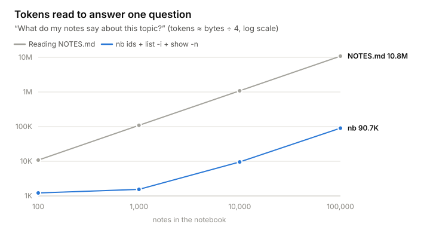
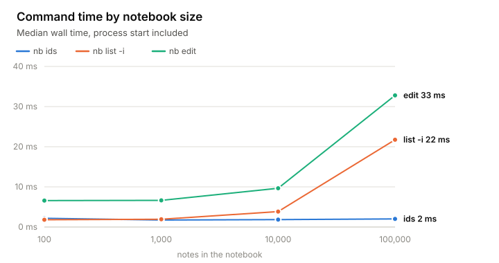
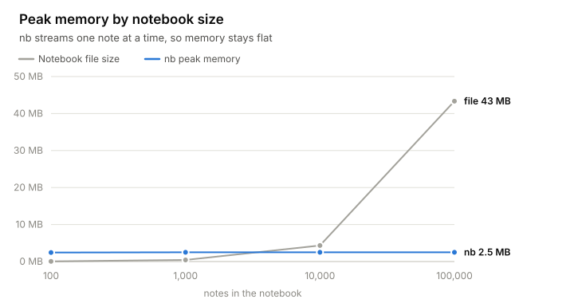

# notebook

[](https://github.com/midori-0/notebook/actions/workflows/ci.yml)

A searchable, single-file notebook for AI agents, written in Rust.

Coding agents keep notes while they work. Left to themselves they write `NOTES.md`, `PLAN.md` and `findings-v2.md`, and every later session pays to read those files again in full. `notebook` (`nb` for short) keeps each subject in one plain-text `.nb` file of small, numbered notes. Each note has a timestamp, a title and identifiers from a dictionary at the top of the file, so an agent reads the index first and opens only the notes it needs.

```text
$ nb ids backend.nb
auth: Login, sessions and tokens
perf: Performance measurements and hotspots

$ nb list backend.nb -i auth
4 2026-11-09T12:56:12Z [auth] Refresh tokens rotate on every use
9 2026-11-10T09:14:03Z [auth,perf] Login p99 is 800 ms, mostly bcrypt

$ nb show backend.nb -n 9
@@ 9 2026-11-10T09:14:03Z [auth,perf] Login p99 is 800 ms, mostly bcrypt
Measured with wrk against staging. bcrypt at cost 14 accounts for 610 ms.
```

## Highlights

- Finding out what a 10,000-note notebook says about one topic takes about 9,600 tokens. Reading the same notes from a markdown file takes about 1.1 million.
- Reads finish in under 5 ms at 10,000 notes, process start included.
- Peak memory stays around 2.5 MB from 100 notes to 100,000.
- Several agents can write to the same notebook. Each write takes a lock and replaces the file atomically.
- Removed notes stay in a trash for 30 days and come back with their original numbers.
- A notebook is a plain-text file that diffs, greps and commits like source code. There is no server or database, and the only dependency is `clap`.

## Compared with markdown notes

| | Markdown notes | notebook |
|---|---|---|
| Find what's known about one topic | Read the whole file | `nb list -i <topic>`, then `nb show -n` for the notes you want |
| Scan without reading bodies | Headings are mixed in with the text | `nb list` prints one header line per note |
| See what changed since yesterday | Dig through git history | `nb list --since 2026-11-11` |
| Topic names | Free text that drifts (`auth`, `login`, `authn`) | Defined once, with a meaning, in the file's dictionary |
| Two agents writing at once | The last write wins | A lock and an atomic rename |
| Undo a deletion | Only if it was committed | `nb restore`, for 30 days |
| Notes that belong beside code | Copy them into another file | A `.nt` link file that points back into the notebook |

## Benchmarks

Measured with [`bench/bench.py`](bench/bench.py) on an Apple M5 Max running macOS 26.6, on generated notebooks with 40 topics. Each time is the median of 30 runs (15 at 100,000 notes) and includes starting the process, since an agent pays that on every call.

<picture>
  <source media="(prefers-color-scheme: dark)" srcset="assets/bench-lookup-dark.svg">
  
</picture>

The question is "what do my notes say about this topic?" With `nb` that's `nb ids`, `nb list -i <topic>` and `nb show` for three of the matching notes. The markdown side reads a `NOTES.md` holding the same notes. Tokens are estimated as bytes ÷ 4.

| Notes | Reading the markdown file | With nb | Fewer tokens |
|---:|---:|---:|---:|
| 100 | 10.8K | 1.2K | 9× |
| 1,000 | 109K | 1.5K | 71× |
| 10,000 | 1.1M | 9.6K | 113× |
| 100,000 | 10.8M | 90.7K | 119× |

`nb`'s cost grows with the number of headers that match. Adding a second `-i` or a `--since` bound narrows the list further.

<picture>
  <source media="(prefers-color-scheme: dark)" srcset="assets/bench-latency-dark.svg">
  
</picture>

| Notes | File | `ids` | `list` | `list -i` | `show -n` | `add` | `edit` | `rm` |
|---:|---:|---:|---:|---:|---:|---:|---:|---:|
| 100 | 0.04 MB | 2.2 ms | 1.8 ms | 1.8 ms | 1.8 ms | 2.0 ms | 6.6 ms | 10.9 ms |
| 1,000 | 0.44 MB | 1.7 ms | 2.0 ms | 1.9 ms | 1.9 ms | 2.2 ms | 6.6 ms | 10.5 ms |
| 10,000 | 4.3 MB | 1.9 ms | 4.2 ms | 3.8 ms | 3.6 ms | 4.0 ms | 9.7 ms | 17.1 ms |
| 100,000 | 43.3 MB | 2.0 ms | 25.8 ms | 21.8 ms | 19.8 ms | 20.5 ms | 32.8 ms | 54.2 ms |

`ids` reads only the dictionary, so its time doesn't depend on the number of notes. `add` appends, but scans the notebook for the next free number. `edit` and `rm` rewrite the file and wait for it to reach the disk before swapping it in. `rm` also writes the note to the trash first.

<picture>
  <source media="(prefers-color-scheme: dark)" srcset="assets/bench-memory-dark.svg">
  
</picture>

Every command reads the notebook one note at a time and copies unchanged notes straight into the replacement file, so peak memory doesn't grow with the notebook.

To run the benchmarks yourself, build a release binary and run the two scripts.

```bash
cargo build --release
python3 bench/bench.py    # writes bench/results.json
python3 bench/plot.py     # redraws the charts in assets/
```

## Install

```bash
cargo install --git https://github.com/midori-0/notebook
```

From a clone, `cargo install --path .` does the same. Both install two identical binaries, `notebook` and `nb`. CI tests every commit on macOS, Linux and Windows.

## Quick start

```bash
nb make backend.nb
nb add backend.nb -i 'auth:Login, sessions and tokens' -t "Refresh tokens rotate on every use" \
  --text "Reusing an old refresh token revokes the whole family."
nb add backend.nb -i auth -t "Session cookie settings" <<'EOF'
- HttpOnly, Secure, SameSite=Lax
- 14-day sliding expiry
EOF
nb list backend.nb -i auth
nb edit backend.nb 1 --text "Reusing an old refresh token revokes every token in its family."
```

`nb add` prints the new note's number. Without `--text`, the body comes from stdin. The first time an identifier is used it needs a meaning, as in `-i 'name:meaning'`. After that, `-i name` is enough.

## Commands

**Writing**

| Command | Description |
|---|---|
| `nb make <file.nb>` | Create an empty notebook |
| `nb add <file> [-i ID]... [-t TITLE] [--text BODY]` | Add a note and print its number |
| `nb edit <file> <n> [-t ...] [--text ...] [-i ...]` | Change a note in place. Only the parts you pass change, `--text -` reads stdin, and `-i` replaces the identifier list. The timestamp becomes now |
| `nb rmid <file> <id>... [-n N]...` | Delete identifiers from the dictionary and every note, or with `-n`, take them off those notes only. Alias `nb untag` |
| `nb link <file.nb> <out.nt> [filters]` | Write a `.nt` link to a selection of notes |

**Reading**

| Command | Description |
|---|---|
| `nb ids <file>` | Print the identifier dictionary |
| `nb list <file> [filters]` | Print note headers |
| `nb show <file> [filters]` | Print full notes |

**Removing and recovering**

| Command | Description |
|---|---|
| `nb rm <file> <n>...` | Move notes to the trash, along with the `.nt` links that depended on them |
| `nb trash <file>` | List removed notes, when each was removed, and their links |
| `nb restore <file> <n>...` | Put notes back under their original numbers and recreate their links |
| `nb purge <file> <n>...` or `--all` | Delete from the trash for good |
| `nb purge --orphans` | Delete trash left by notebooks that no longer exist |

`list`, `show` and `link` accept the same filters.

- `-n 3 -n 5` matches any of the given note numbers.
- `-i api -i bug` matches notes that carry every given identifier.
- `--since 2026-11` and `--until 2026-11-09` are inclusive time bounds. Any prefix of a timestamp works.

Every command accepts a `.nt` link in place of a notebook. `nb show docs/api.nt` prints the link's selection, and `nb add docs/api.nt ...` writes to the notebook it points at.

## Links

A `.nt` file puts a selection of notes next to the code it describes, without copying anything.

```bash
nb link backend.nb services/auth/auth.nt -i auth    # every auth note
nb link backend.nb handoff.nt -n 30 -n 31           # two specific notes
```

A link stores a relative path to its notebook and a selection, so it survives the repository moving. The notebook records its links. When `nb rm` removes the notes a link names, or every note it selects, the link goes to the trash too and `nb restore` brings it back. Links whose selection still matches other notes are left alone.

## Trash

Removed notes and links are kept in `~/.cache/notebook/<uid>/` (`%LOCALAPPDATA%\notebook\<uid>\` on Windows, or under `$XDG_CACHE_HOME` when it's set). Each notebook has a permanent uid, so its trash follows it through moves and renames.

Entries expire after 30 days, and `NB_TRASH_DAYS` changes that. Note numbers are never reused, so a restored note gets its old number back and links can't end up pointing at a different note.

## Claude Code integration

### The `/notebook` skill

[`skills/notebook/`](skills/notebook/SKILL.md) tells agents when a note is worth writing and how to keep notebooks easy to search. It also switches notebook mode.

```text
/notebook on       agents keep their own notes in nb, and new .md files need your approval
/notebook off      agents write markdown as usual and use nb only when asked
/notebook status   shows the current mode
```

The mode is global and on by default. It's stored in `~/.claude/notebook-mode`, and `NB_MODE_FILE` points it elsewhere. Switching it mid-session changes how the current session behaves from then on.

Two hooks do the enforcing. [`hooks/session-start.sh`](hooks/session-start.sh) gives each new, resumed, cleared or compacted session the rule in [`rule.txt`](skills/notebook/rule.txt) while the mode is on. [`hooks/md-guard.sh`](hooks/md-guard.sh) asks for your approval before an agent creates a new `.md` file, unless it's a standard project file such as a README, CHANGELOG, CLAUDE.md or AGENTS.md, or it sits under `.claude/` or an existing `docs/` folder. Files named like notes, such as `PLAN.md`, `NOTES.md` or `handoff.md`, are asked about even inside `docs/`.

To set it up, link the skill and add both hooks to `~/.claude/settings.json`. They are shell scripts that need `jq`, and on Windows they run under Git Bash.

```bash
ln -s "$PWD/skills/notebook" ~/.claude/skills/notebook
```

```json
{ "hooks": {
  "SessionStart": [ { "hooks": [ { "type": "command", "command": "/path/to/notebook/hooks/session-start.sh" } ] } ],
  "PreToolUse": [ { "matcher": "Write",
    "hooks": [ { "type": "command", "command": "/path/to/notebook/hooks/md-guard.sh" } ] } ] } }
```

Keep the notebook rule out of `~/.claude/CLAUDE.md`. A line there applies regardless of the mode, and `/notebook off` can't override it.

### Edit cards for notebook writes

[`plugins/nb-diff/`](plugins/nb-diff/) is a Claude Code mod that draws each notebook write (`make`, `add`, `edit`, `rmid`, `rm`, `restore`, `link`) as Claude Code's own Edit card for the `.nb` file, with line numbers and red and green changes. It changes only the display, so the agent's output and token use stay the same.

```bash
claude plugin install nb-diff --marketplace midori-0/notebook
```

## File format

```text
notebook v1
uid backend.nb-64c6f45652a04287
id auth: Login, sessions and tokens
last 9
link services/auth/auth.nt

@@ 4 2026-11-09T12:56:12Z [auth] Refresh tokens rotate on every use
Reusing an old refresh token revokes the whole family.

```

| Line | Meaning |
|---|---|
| `uid <id>` | Permanent id, also the name of the notebook's trash folder |
| `id <name>: <meaning>` | One entry in the identifier dictionary |
| `last <n>` | Highest note number ever used |
| `link <path>` | A registered `.nt` link, relative to the notebook's folder |
| `@@ <n> <timestamp> [<ids>] <title>` | A note header, followed by its markdown body and a blank line |

Body lines that start with `@@` or `\` are stored with an extra `\` in front. Timestamps are UTC RFC 3339, which sorts as plain text and is why `--since` and `--until` accept any prefix. Paths in links always use `/`, so a notebook and its links move freely between macOS, Linux and Windows.

## How it works

`nb` reads a notebook in 64 KB chunks and finds note boundaries with a word-at-a-time newline search, so it holds roughly one note in memory at a time. `ids` stops reading after the dictionary.

A rewrite goes to a temporary file, which is synced to disk and then renamed over the notebook, so a crash leaves either the old file or the new one. Writers lock a small file in the cache rather than the notebook itself. On Windows, where file locks are mandatory, that keeps the notebook readable during a write.

`rm` writes notes to the trash before it rewrites the notebook. If it crashes in between, the note ends up in both places.

## Development

```bash
cargo test                            # format, filters, editing, trash, moves (CI: macOS, Linux, Windows)
cargo clippy --all-targets -- -D warnings
hooks/md-guard.test.sh                # hooks and the mode switch
claude plugin test plugins/nb-diff    # the edit-card mod
```

| Path | Contents |
|---|---|
| `src/format.rs` | The `.nb` format and the streaming reader |
| `src/store.rs` | Opening, locking and atomically replacing files |
| `src/trash.rs` | Removed notes, expiry and orphan sweeps |
| `src/read.rs`, `write.rs`, `remove.rs`, `untag.rs` | The commands |
| `src/cli.rs` | Argument parsing and output |
| `skills/notebook/` | The `/notebook` skill, its mode switch and the session rule |
| `hooks/` | The session and `.md` guard hooks, with their self-check |
| `plugins/nb-diff/` | The edit-card mod |
| `bench/` | Benchmark and chart scripts, and the latest results |

## Limitations

- There's no full-text search over note bodies. Notes are found by identifier, number and time, and `grep` works on the file.
- Commands that rewrite the file (`edit`, `rm`, `restore`, `rmid`, `link`, and `add` with a new identifier) take time in proportion to the notebook's size. An edit at 100,000 notes takes 33 ms.
